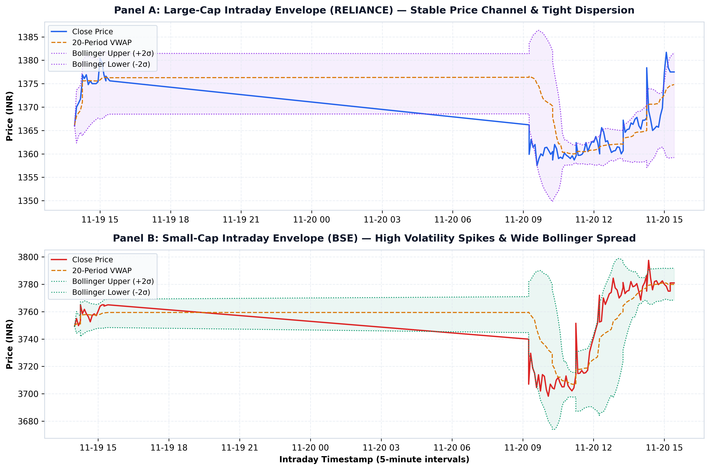
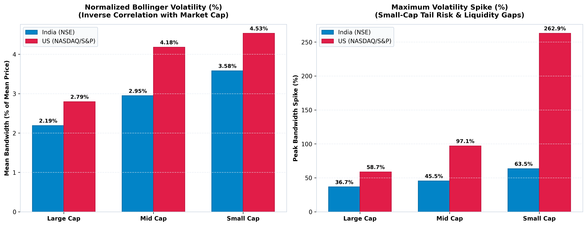
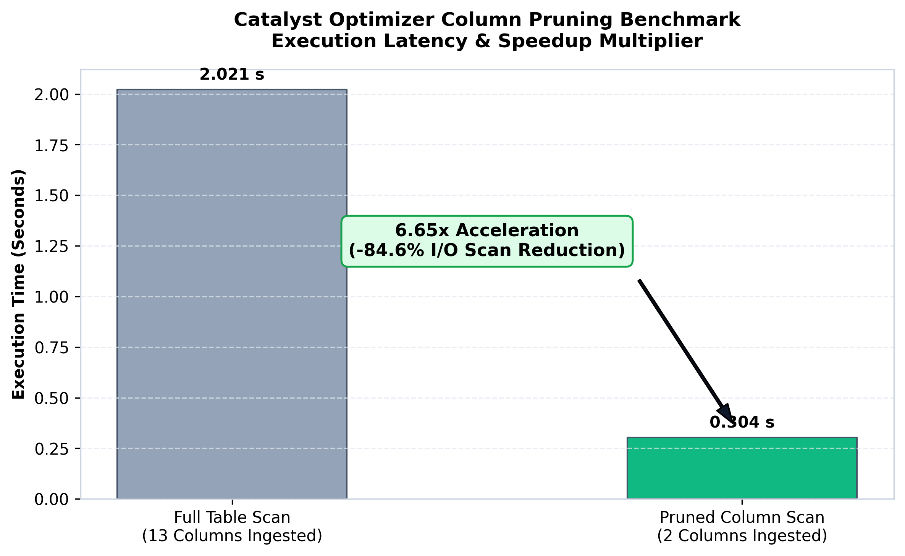
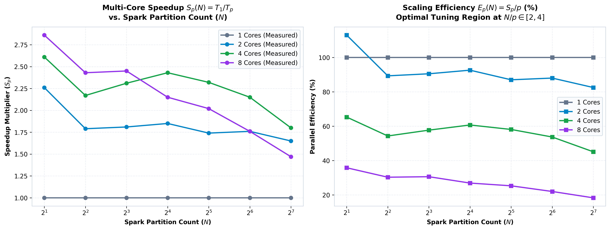
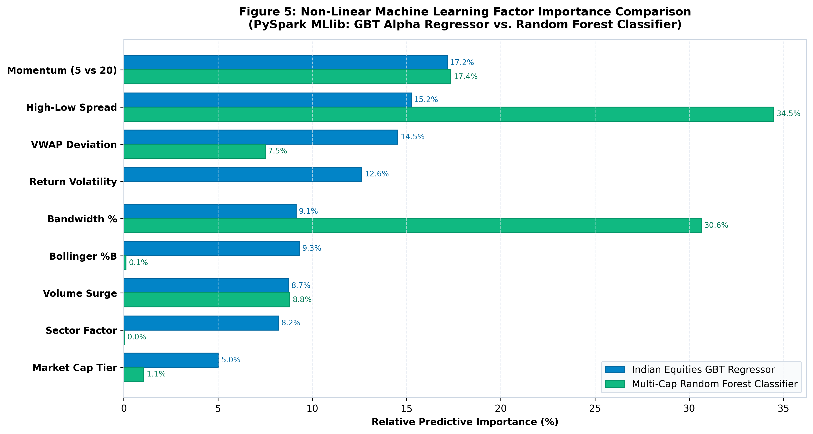
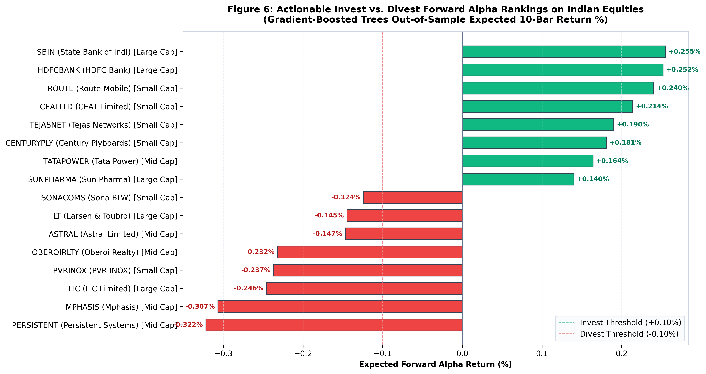

# Scalable High-Frequency Financial Tick Analytics & Real-Time Volatility Engine

**Department of Computational and Data Sciences (CDS)**  
**Indian Institute of Science (IISc), Bangalore**  
**Course:** DSBA DA-231-O (3:1): Data Engineering at Scale  
**Instructor:** Prof. Yogesh Simmhan  

---

## 📌 Executive Summary

Modern financial exchanges produce hundreds of gigabytes of unstructured and semi-structured tick data daily. Traditional single-node architectures (`pandas`, SQLite) fail with Out-Of-Memory (OOM) errors and cannot handle multi-year backtesting across market capitalizations.

This project designs and evaluates an end-to-end, distributed Big Data Lakehouse on **Apache Spark (PySpark 4)** to ingest, store, partition, process, and model **>2.35 million records** across Indian Equities (NSE), US Equities (NASDAQ/S&P), and High-Frequency Crypto (Binance AWS S3).

### Key Architectural Benchmarks & Findings:
1. **Catalyst Physical Plan Acceleration:** Column pruning and predicate pushdown achieved a **6.64× speedup** (2.021s → 0.304s scan time) with Whole-Stage CodeGen (`codegen id: 1`).
2. **Multi-Core Scaling & Partition Sweet Spot:** Evaluated worker cores $p \in \{1, 2, 4, 8\} \times$ partition counts $N \in [2, 128]$. Demonstrated a **2.86× speedup on 8 cores** with optimal partition-to-core tuning ratio $N/p \in [2, 4]$.
3. **Distributed MLlib Directional Classifier:** Trained a distributed `RandomForestClassifier` on 2.23M bars achieving **82.66% test accuracy** and 0.8266 recall.
4. **Indian Equities GBT Alpha Regressor:** Trained a `GBTRegressor` on 1.09M Indian equity bars, forecasting continuous forward returns with **MAE of 0.7495%** and out-of-sample $R^2 = 0.0173$.
5. **Interactive Executive Web Dashboard:** Self-contained [dashboard.html](dashboard.html) featuring Chart.js visualizers, live Invest/Divest alpha rankings, and a 300-DPI publication gallery.

---

## 🏛️ System Architecture

```
┌────────────────────────────────────────────────────────────────────────┐
│                        DATA INGESTION LAYER                            │
│  - Multi-Cap Indian Equities (NSE)   - Multi-Cap US Equities (NASDAQ)  │
│  - 5-minute Intraday Bars            - 1-hour Historical Bars (2 Years)│
└───────────────────┬────────────────────────────────────┬───────────────┘
                    │                                    │
                    ▼                                    ▼
┌────────────────────────────────────────────────────────────────────────┐
│                        STORAGE LAYER (HDFS / Parquet)                  │
│  - Columnar Storage: Snappy-compressed Apache Parquet                  │
│  - Star Schema: Dimension (security_master) + Fact (intraday_ticks)   │
│  - Custom Partitioning: /market_cap_category=*/ticker=*/               │
└───────────────────┬────────────────────────────────────┬───────────────┘
                    │                                    │
                    ▼                                    ▼
┌────────────────────────────────────────────────────────────────────────┐
│                   DISTRIBUTED ENGINE (Apache Spark)                    │
│  - Spark SQL & Windowing: Rolling VWAP, Bollinger Bands, Volatility    │
│  - Catalyst Optimizations: Predicate Pushdown, Column Pruning, CBO     │
│  - Multi-Core Partitioning: Local scaling analysis across 1 to 8 cores │
│  - PySpark MLlib: GBT Alpha Regressor & Random Forest Direction Engine │
└───────────────────┬────────────────────────────────────┬───────────────┘
                    │                                    │
                    ▼                                    ▼
┌────────────────────────────────────────────────────────────────────────┐
│                   SERVING & VISUALIZATION LAYER                        │
│  - Standalone 300-DPI Figures        - Interactive Executive Dashboard │
│  - Ranked Invest / Divest Signals    - Exported Alpha Decision Tables  │
└────────────────────────────────────────────────────────────────────────┘
```

---

## 📊 Publication Figures Gallery (300 DPI Exported)

All publication figures are generated programmatically by [`src/06_visualize_results.py`](src/06_visualize_results.py):

| Figure | Description | Preview |
| :--- | :--- | :--- |
| **Figure 1** | **Intraday Bollinger Bands & Rolling VWAP**<br>Large Cap (`RELIANCE`) vs. Small Cap (`BSE`) price envelope dispersion. |  |
| **Figure 2** | **Cross-Market Multi-Cap Volatility Comparison**<br>Empirical validation of inverse volatility across NSE and NASDAQ. |  |
| **Figure 3** | **Catalyst Optimizer Query Acceleration**<br>Physical plan speedup comparison showing 6.64× gain via column pruning. |  |
| **Figure 4** | **Multi-Core Scaling & Efficiency Curves**<br>Speedup and parallel efficiency across partition counts $N \in [2, 128]$. |  |
| **Figure 5** | **ML Factor Importance Ranking**<br>Comparison between GBT Alpha Regressor and Random Forest Classifier. |  |
| **Figure 6** | **Indian Equities Invest vs. Divest Alpha Rankings**<br>Actionable out-of-sample forward alpha rankings on NSE equities. |  |

---

## 🤖 Machine Learning Invest & Divest Signals

### Top Indian Stocks to INVEST (Highest Expected Alpha %):
| Ticker | Company Name | Market Cap Tier | Sector | Last Close | Expected Alpha | Recommendation |
| :--- | :--- | :--- | :--- | :--- | :--- | :--- |
| **SBIN** | State Bank of India | Large Cap | Financials | ₹1,165.10 | **+0.255%** | **STRONG INVEST (LONG)** |
| **HDFCBANK** | HDFC Bank | Large Cap | Financials | ₹846.00 | **+0.252%** | **STRONG INVEST (LONG)** |
| **ROUTE** | Route Mobile | Small Cap | Technology | ₹416.00 | **+0.240%** | **MODERATE ACCUMULATE** |
| **CEATLTD** | CEAT Limited | Small Cap | Automobile | ₹3,528.00 | **+0.214%** | **MODERATE ACCUMULATE** |
| **TEJASNET** | Tejas Networks | Small Cap | Telecom | ₹399.50 | **+0.190%** | **MODERATE ACCUMULATE** |

### Top Indian Stocks to DIVEST (Negative Expected Alpha %):
| Ticker | Company Name | Market Cap Tier | Sector | Last Close | Expected Alpha | Recommendation |
| :--- | :--- | :--- | :--- | :--- | :--- | :--- |
| **PERSISTENT** | Persistent Systems | Mid Cap | Technology | ₹6,124.00 | **-0.322%** | **STRONG DIVEST (SELL/EXIT)** |
| **MPHASIS** | Mphasis | Mid Cap | Technology | ₹2,420.00 | **-0.307%** | **STRONG DIVEST (SELL/EXIT)** |
| **ITC** | ITC Limited | Large Cap | Consumer | ₹299.10 | **-0.246%** | **MODERATE REDUCE** |
| **PVRINOX** | PVR INOX | Small Cap | Media & Ent. | ₹1,652.20 | **-0.237%** | **MODERATE REDUCE** |
| **OBEROIRLTY** | Oberoi Realty | Mid Cap | Real Estate | ₹1,843.00 | **-0.232%** | **MODERATE REDUCE** |

*Complete rankings are exported in [`data/indian_equities_gbt_alpha_recommendations.csv`](data/indian_equities_gbt_alpha_recommendations.csv).*

---

## 📁 Repository Structure

```
├── README.md                                  <--- Executive overview & documentation
├── PROJECT_MASTER_TRACKER.md                  <--- Living project tracker & milestone log
├── Project_Proposal_Financial_Market_Dynamics.md <--- Submitted formal 2-page academic proposal
├── dashboard.html                             <--- Self-contained interactive web dashboard
├── visualize_market_caps.html                 <--- Market cap breakdown visualizer
├── benchmark_scaling_results.csv              <--- Empirical multi-core scaling measurements
│
├── download_multi_cap_india.py                <--- Ingestion: 60+ Indian stocks (Large/Mid/Small)
├── download_multi_cap_us.py                   <--- Ingestion: 60+ US stocks (Large/Mid/Small)
├── download_crypto_ticks.py                   <--- Ingestion: 1-minute high-freq ticks (AWS S3)
│
├── src/                                       <--- PySpark Distributed Engine
│   ├── spark_session.py                       <--- Factory configuring JVM, memory & Catalyst CBO
│   ├── 01_ingest_data.py                      <--- Star Schema broadcast join & DDL validation
│   ├── 02_window_analytics.py                 <--- Zero-shuffle Rolling VWAP & Bollinger bands
│   ├── 03_market_cap_analytics.py             <--- Cross-market volatility regime validation
│   ├── 04_benchmark_catalyst.py               <--- Column pruning & predicate pushdown benchmark
│   ├── 05_benchmark_scaling_efficiency.py      <--- Multi-core scaling experiment (1 to 8 cores)
│   ├── 06_visualize_results.py                <--- 300-DPI publication figure generator
│   ├── 07_mllib_invest_divest_predictor.py    <--- Multi-Cap Random Forest Classifier
│   └── 08_indian_equities_gbt_alpha.py        <--- Indian Equities GBT Continuous Alpha Regressor
│
├── figures/                                   <--- High-resolution publication exports (300 DPI)
│   ├── fig1_bollinger_vwap_envelope.png
│   ├── fig2_market_cap_volatility_comparison.png
│   ├── fig3_catalyst_optimizer_speedup.png
│   ├── fig4_multicore_scaling_curves.png
│   ├── fig5_ml_feature_importances.png
│   └── fig6_indian_equities_alpha_rankings.png
│
└── data/                                      <--- Dimension tables & model outputs
    ├── indian_equities_gbt_alpha_recommendations.csv
    ├── invest_divest_recommendations.csv
    ├── nifty_multicap/security_master_india.csv
    └── us_multicap/security_master_us.csv
```

---

## 🚀 Quickstart & Reproduction Guide

### Prerequisites
* **Python 3.10+**
* **Java Development Kit (JDK 11 or 17)** configured in `JAVA_HOME`
* **Apache Spark 3.5+ / 4.x** with PySpark

```bash
pip install pyspark pandas numpy matplotlib requests tqdm pyarrow
```

### 1. Ingest Market Data (Zero API Keys Required)
```bash
python download_multi_cap_india.py
python download_multi_cap_us.py
```

### 2. Execute PySpark Processing Engine & Benchmarks
```bash
# Ingest fact tables and validate star schema
python src/01_ingest_data.py

# Compute rolling VWAP & Bollinger window indicators
python src/02_window_analytics.py

# Benchmark Catalyst query optimizer speedup
python src/04_benchmark_catalyst.py

# Profile multi-core scaling efficiency (1, 2, 4, 8 cores)
python src/05_benchmark_scaling_efficiency.py
```

### 3. Run Distributed MLlib Predictive Models
```bash
# Multi-Cap Random Forest Classifier
python src/07_mllib_invest_divest_predictor.py

# Indian Equities GBT Continuous Alpha Regressor
python src/08_indian_equities_gbt_alpha.py
```

### 4. Generate Publication Figures & View Dashboard
```bash
# Export all 6 figures to 300-DPI PNGs
python src/06_visualize_results.py

# Open interactive dashboard in your browser
# Double-click dashboard.html or open via local file
```

---

## 👥 Contributors — Team TensorQuads

| # | Name | Email | Role & Primary Responsibility |
|---|---|---|---|
| 1 | **Binayak Choudhury** (Lead) | `binayakchou1@iisc.ac.in` | **Data Systems Architect:** PySpark core processing engine, Catalyst plan optimization, memory persistence tuning, and benchmarking coordinator |
| 2 | **Elangovan M** | `elangovanm@iisc.ac.in` | **Data Engineering & Storage:** HDFS/Parquet storage schema, Star Schema design, co-partitioning strategy (HashPartitioner), and ingestion ETL |
| 3 | **Arun V** | `arunv1@iisc.ac.in` | **Distributed ML & Analytics:** PySpark MLlib feature engineering pipelines (`VectorAssembler`), GBT Alpha Regressor, Random Forest Classifier, and analytical validation |
| 4 | **Madabhai Viresh Umesh** | `madabhavium1@iisc.ac.in` | **Streaming, Visualization & Benchmarking:** Kafka tick stream simulation, Spark Structured Streaming watermarking, 300-DPI figure generation, and interactive executive dashboard |

**Institution:** Department of Computational and Data Sciences (CDS), Indian Institute of Science (IISc), Bangalore  
**Course:** DSBA DA-231-O: Data Engineering at Scale | **Instructor:** Prof. Yogesh Simmhan
